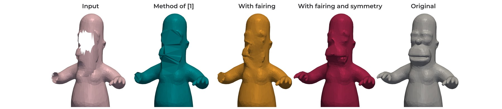
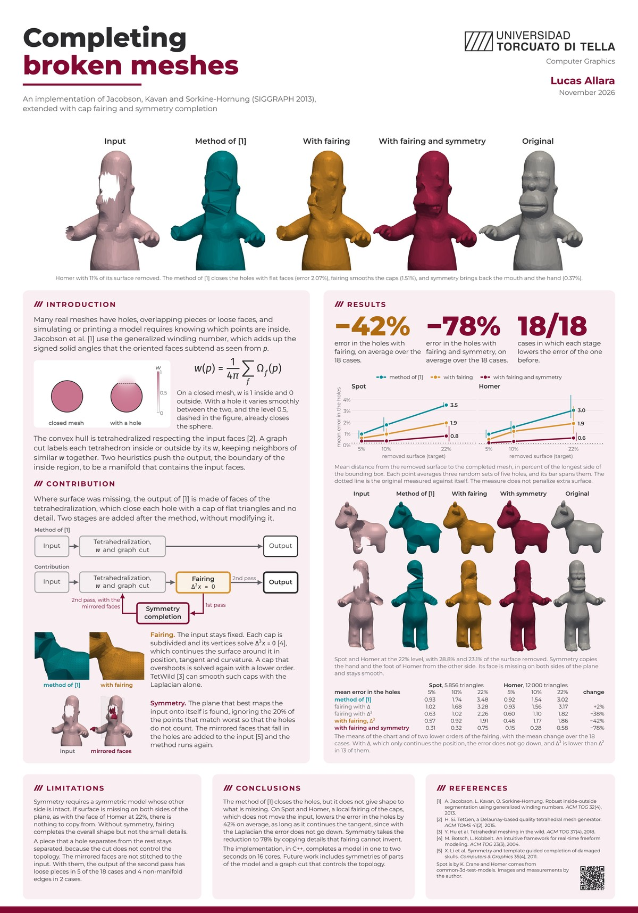
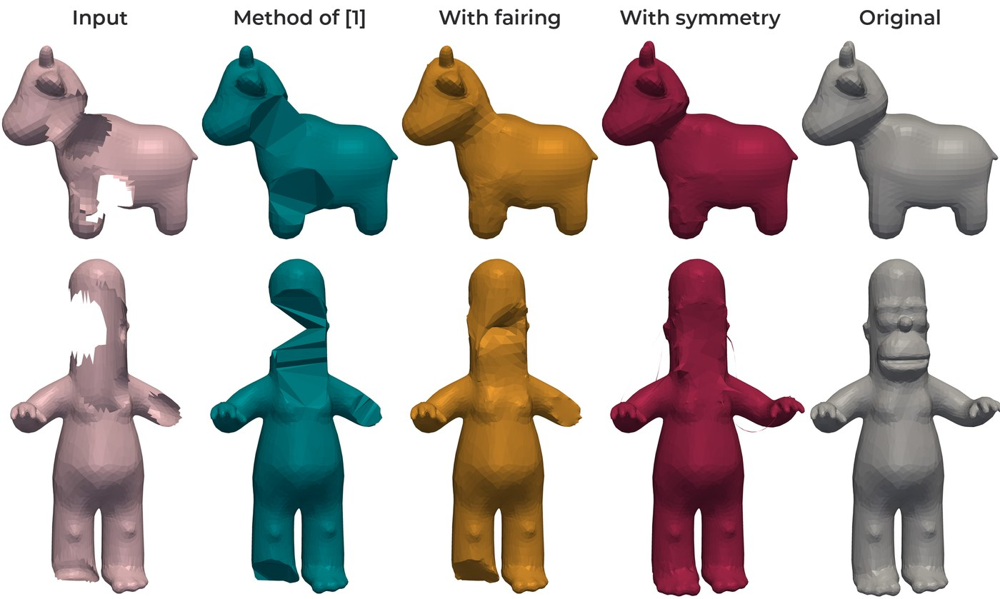
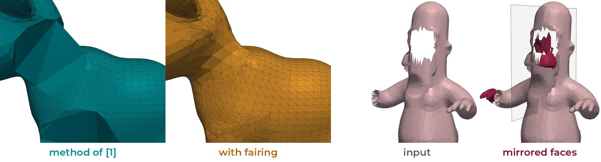

# Completing broken meshes

An implementation in C++ of *Robust Inside-Outside Segmentation using Generalized Winding Numbers* (Jacobson, Kavan and Sorkine-Hornung, SIGGRAPH 2013), extended with cap fairing and symmetry completion so that the holes of a broken mesh get back their shape.

Lucas Allara · Computer Graphics, Universidad Torcuato Di Tella · November 2026

[Poster](poster/poster.pdf) (PDF, 9.4 MB) &nbsp;·&nbsp; [Paper](https://doi.org/10.1145/2461912.2461916) &nbsp;·&nbsp; [Project page of the paper](https://igl.ethz.ch/projects/winding-number/)

<p align="center">
  
</p>

## About

Many real meshes have holes, overlapping pieces or loose faces, and simulating or printing a model requires knowing which points lie inside. Jacobson et al. answer that with the generalized winding number, the sum of the solid angles that the faces subtend at a point, divided by 4π, which is 1 inside a closed mesh and 0 outside and degrades smoothly where the mesh is broken. Space is tetrahedralized with every input triangle as a face, the winding number is evaluated in each tetrahedron, and a graph cut labels each tetrahedron as inside or outside while penalizing the separation of similar neighbors. Two heuristics then push the output, the boundary of the inside region, to contain the input faces and to be a manifold.

Where surface was missing, that output is made of faces of the tetrahedralization, so it closes each hole with flat triangles and no detail. This repository implements the method in C++17 and adds two stages after it without modifying it. Fairing keeps the input fixed, subdivides each cap and moves its vertices so that they solve Δ³x = 0 with the uniform Laplacian, which continues the surrounding surface in position, tangent and curvature, and a cap that overshoots is solved again with a lower order. The idea comes from TetWild, which can smooth the surface that closes the holes with the Laplacian. Symmetry completion finds the plane that best maps the input onto itself, mirrors the input across it and adds the mirrored faces that fall in the holes, then runs the method a second time, which restores details that fairing cannot invent.

> **Robust Inside-Outside Segmentation using Generalized Winding Numbers**<br>
> Alec Jacobson, Ladislav Kavan, Olga Sorkine-Hornung<br>
> *ACM Transactions on Graphics* 32(4), SIGGRAPH 2013<br>
> [Project page](https://igl.ethz.ch/projects/winding-number/) · [Paper](https://doi.org/10.1145/2461912.2461916)

## Poster

The poster gives the method and the results on one 70 × 100 cm page, and `poster/` holds its LaTeX source and the script that renders its figures.

<p align="center">
  <a href="poster/poster.pdf"></a>
</p>
<p align="center"><sub>The image opens the PDF (9.4 MB).</sub></p>

## Results

Three random sets of five holes are punched in Spot and in Homer at each of three levels of damage, 18 cases in all. The levels are named after their targets, 5 %, 10 % and 22 % of the surface, and the holes remove 5.6 %, 11.6 % and 25.4 % on average. The error is the mean distance from the missing part of the true surface to the reconstruction, as a percentage of the longest side of the bounding box, and every value below is the mean over the three sets of holes. The distance is taken to 300 000 points sampled on the reconstruction, which adds up to about 0.1 % to each value, since even the true surface measured against itself gives 0.13 % on Spot and 0.09 % on Homer.

| mean error in the holes       | Spot, 5 % | Spot, 10 % | Spot, 22 % | Homer, 5 % | Homer, 10 % | Homer, 22 % | mean change |
|:------------------------------|----------:|-----------:|-----------:|-----------:|------------:|------------:|------------:|
| method of the paper           |    0.93 % |     1.74 % |     3.48 % |     0.92 % |      1.54 % |      3.02 % |             |
| fairing with the Laplacian    |    1.02 % |     1.68 % |     3.28 % |     0.93 % |      1.56 % |      3.17 % |        +2 % |
| fairing with the bi-Laplacian |    0.63 % |     1.02 % |     2.26 % |     0.60 % |      1.10 % |      1.82 % |       −38 % |
| with fairing (tri-Laplacian)  |    0.57 % |     0.92 % |     1.91 % |     0.46 % |      1.17 % |      1.86 % |       −42 % |
| with fairing and symmetry     |    0.31 % |     0.32 % |     0.75 % |     0.15 % |      0.28 % |      0.58 % |       −78 % |

Fairing lowers the error in all 18 cases, by 42 % on average, and fairing with symmetry lowers it by 78 %, also in all 18 cases. The last column is the mean of the changes of the 18 cases against the method of the paper. The second and third rows fair the same caps with lower orders. With the Laplacian, which only continues the position of the surface around the cap, the error does not go down, since it ends 2 % higher on average and lower in only 7 of the 18 cases. With the bi-Laplacian it goes down by 38 %, in all 18 cases, and the tri-Laplacian is below it in 13 of them. The fairing lowers the order of a cap that leaves the box of its border vertices, which happens to 14 of the 73 caps of the first pass, 12 of them on Homer, where those two rows end close. Each reconstruction, both passes included, took between 0.9 and 2.1 s on a laptop with 16 cores. [`results/damage_levels.json`](results/damage_levels.json) holds every number of this section, one row per case.

<p align="center">
  
</p>
<p align="center"><sub>Spot and Homer at the 22 % level, where the holes remove 28.8 % and 23.1 % of their surface. From left to right, the input, the method of the paper (marked [1], as in the poster), with fairing, with fairing and symmetry, and the original.</sub></p>

<p align="center">
  
</p>
<p align="center"><sub>Left, a hole in the neck of Spot closed by the method of the paper and by fairing. Right, the faces of Homer mirrored across its symmetry plane that fall in the holes.</sub></p>

## Limitations

Symmetry requires a symmetric model whose other side is intact. If surface is missing on both sides of the plane, as with the face of Homer at 22 %, there is nothing to copy from. Without symmetry, fairing completes the overall shape but not the small details. A piece that a hole separates from the rest stays separated, because the cut does not control the topology.

The second pass adds the mirrored faces without stitching them to the input. The outputs of the method and of fairing are closed manifolds in all 18 cases, while the output with symmetry has loose pieces in 5 of them and 4 non-manifold edges in 2. That pass is also sensitive to the last digits of the plane. With `--axes tests/reference_axes.txt`, `gsd_experiment` starts the search for the plane from the same principal axes with other signs, and the error with symmetry of single cases moves by up to 47 %, while its mean reduction goes from 77.9 % to 78.6 % and it stays below the error of fairing in all 18 cases ([`results/damage_levels_reference_axes.json`](results/damage_levels_reference_axes.json)).

TetGen aborts the whole process when two triangles of the constraint intersect, so intersecting triangles are detected and subdivided first, and the pieces that still intersect are left out of the constraint, although they still count for the winding number. The detection misses some coplanar overlaps, such as a small box standing on a larger one, and those inputs still abort the process.

The tolerances and the weight of the smoothness term are absolute, tuned for models about one unit across, so the result changes with the size of the model. The experiment scales every model to a longest side of 1.35 and `gsd_complete` does the same, and a model in other units has to be rescaled before `reconstruct_with_symmetry` is called.

## Building

| part | needs |
|:--|:--|
| the library, the programs and the tests | CMake 3.16, a C++17 compiler with OpenMP, and Eigen 3.3 or later |
| the figures of the poster and of this page | Python 3 with numpy, scipy, matplotlib, pyvista, pillow and pypdfium2 |
| the poster | LuaLaTeX with TikZ, the `qrcode` package and the Montserrat and Fira Math fonts |

```bash
cmake -S . -B build && cmake --build build -j
ctest --test-dir build          # 8 tests, about 10 s
python -m venv .venv
.venv/bin/pip install numpy scipy matplotlib pyvista pillow pypdfium2
```

The configuration downloads the three source files of TetGen 1.6.0, which is not part of this repository. The linear systems of the fairing go through Eigen, and the evaluations of the winding number, the nearest-point searches and the intersection tests run in parallel with OpenMP. The code was developed and measured on Linux.

The tests compare every stage with reference values of the Python implementation that preceded this code (numpy, scipy and the `tetgen` package), which is not part of the repository. The code follows it step by step, with the random generator of numpy reimplemented so that the holes and the samples are the same. On Spot with the holes of the 10 % level, the generator gives the same numbers bit for bit, the winding numbers agree within 1e-13, the method gives the same error to 12 digits and fairing to 9, and from the starting axes of the reference the second pass gives its error with symmetry to 9 digits.

## Usage

`gsd_complete` completes a broken mesh. It writes the result with symmetry when a symmetry plane is found and mirrored faces fall in the holes, and the faired one otherwise. `--method` and `--fairing` stop at those stages, and `--all` also writes the output of every stage that ran. It scales the model to the size of the experiment and takes the result back to the coordinates of the input, whose vertices come out bit for bit.

```bash
build/gsd_complete broken.obj completed.obj
build/gsd_complete broken.obj completed.obj --all stage     # also stage_method.obj, stage_faired.obj and, with symmetry, stage_symmetry.obj
```

`gsd_slice` samples the winding number of a mesh on a plane through the origin, which is how the figure of the introduction of the poster is drawn.

```bash
build/gsd_slice broken.obj slice.txt --axis z --resolution 320
```

The same pipeline is available as a library, with one header per stage in `include/gsd/`.

```cpp
#include "gsd/mesh.h"
#include "gsd/symmetry.h"

const gsd::Mesh broken = gsd::load_obj("broken.obj");        // about one unit across
const gsd::Reconstruction r = gsd::reconstruct_with_symmetry(broken);
if (r.has_symmetry) gsd::save_obj(r.symmetry_V, r.symmetry_F, "completed.obj");
else gsd::save_obj(r.faired_V, r.faired_F, "completed.obj");
```

`r.method_V` and `r.method_F` hold the output of the method of the paper alone, which `graphcut_segment` in `gsd/segmentation.h` computes.

| header | content |
|:--|:--|
| `gsd/winding.h` | the generalized winding number, by the solid angle of every face and by the hierarchy of Section 4.3 of the paper |
| `gsd/conforming.h` | the tetrahedralization of the convex hull with every input triangle as a face, through TetGen |
| `gsd/segmentation.h`, `gsd/maxflow.h` | the energy of Equation 8 of the paper and its minimum cut |
| `gsd/constraints.h` | the two heuristics of Section 5.2, input faces on the output and a manifold output |
| `gsd/fairing.h` | the tri-Laplacian fairing of the caps |
| `gsd/symmetry.h`, `gsd/neldermead.h` | the symmetry plane, the mirrored faces and the two passes |
| `gsd/mesh.h`, `gsd/tetmesh.h`, `gsd/shapes.h` | triangle and tetrahedral meshes, OBJ files, test shapes and random holes |
| `gsd/rng.h`, `gsd/kdtree.h` | the random generator of numpy and the nearest-point search |

## Reproducing the results

| output | command |
|:--|:--|
| `results/damage_levels.json` and the meshes of every case in `results/meshes/` | `build/gsd_experiment . results/damage_levels.json --meshes results/meshes` |
| `results/damage_levels_reference_axes.json` | `build/gsd_experiment . results/damage_levels_reference_axes.json --axes tests/reference_axes.txt` |
| the figures of the poster, then `poster/poster.pdf` | `.venv/bin/python poster/poster_figures.py`, then `poster/build.sh` |
| `figures/readme/` | `.venv/bin/python poster/readme_figures.py` |

The experiment takes about a minute. Its errors do not change from one run to another, only the field `seconds` does, and the meshes are not versioned because they are written again each time. `poster/poster_figures.py` renders those meshes, draws the plot from the numbers and runs `build/gsd_slice` for the slices of the winding number. It takes Montserrat from where `kpsewhich` finds it, or from the TinyTeX tree in the home directory (`tlmgr install pgf qrcode montserrat firamath` installs what the poster needs).

## Repository layout

```
Broken-mesh-completion/
├── include/gsd/   winding numbers, tetrahedralization, graph cut, constraints, fairing, symmetry
├── src/           the implementation of each header
├── apps/          gsd_complete, gsd_experiment and gsd_slice
├── tests/         the tests, their reference values and the inputs that must fail with a message
├── assets/        the test models (Spot, Homer, Lucy)
├── results/       the numbers of the experiment, one row per case
├── figures/       readme/, with the images of this page
└── poster/        the poster (poster.pdf), its LaTeX source and the scripts of its figures
```

## Credits and license

The code of this repository is under the MIT license ([`LICENSE`](LICENSE)). The programs are built with the sources of TetGen, which is under the AGPL-3.0 or later and is not part of this repository, so the AGPL governs those programs and any distribution of this code together with TetGen.

Spot is by Keenan Crane, who released it into the public domain ([`assets/spot/README.txt`](assets/spot/README.txt)). Homer and Lucy are copied from [common-3d-test-models](https://github.com/alecjacobson/common-3d-test-models), whose table attributes Lucy to the Stanford 3D Scanning Repository and lists the source of Homer as unclear. The MIT license covers the code and not the models, which keep the terms of their sources.

## Citation

This repository has no paper of its own, so work that uses it should cite the paper it extends, together with the repository as [`CITATION.cff`](CITATION.cff) describes it.

```bibtex
@article{jacobson13winding,
  title     = {Robust Inside-Outside Segmentation using Generalized Winding Numbers},
  author    = {Jacobson, Alec and Kavan, Ladislav and Sorkine-Hornung, Olga},
  journal   = {ACM Transactions on Graphics (Proceedings of SIGGRAPH 2013)},
  volume    = {32},
  number    = {4},
  year      = {2013},
  publisher = {ACM},
  doi       = {10.1145/2461912.2461916}
}
```
